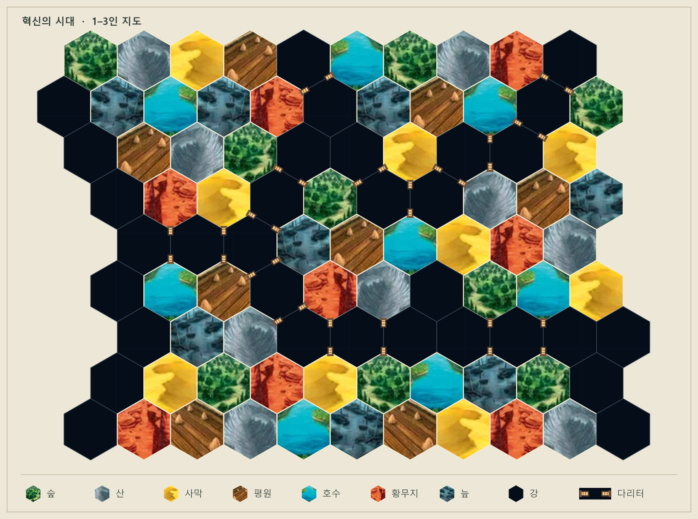

# 혁신의 시대 오토마 플레이

사람 한 명이 브라우저에서 오토마와 대국하기 위한 프로젝트다. 작은 보드에 난이도별 초기 배치를 만든 뒤, 일반 건설·개량 행동과 도시·영역 점수를 판정할 수 있다. 오토마가 건설 후보를 좁히는 과정과 호출 방법은 [보드 판정 문서](docs/board-rules.md)에 정리했다.



## 개발

Node.js 24에서 아래 명령으로 의존성을 설치하고 검증한다.

```sh
npm install
npm test
npm run render:board
```

## 폴더 구조

| 경로 | 용도 |
|---|---|
| `src/game/` | 보드 좌표, 규칙, 점수 타일, 초기 세팅 |
| `src/game/data/` | 결정 카드 등 고정 데이터 |
| `src/render/` | 게임 좌표를 화면에 그리는 렌더러 |
| `public/boards/` | 지형 원화와 생성된 보드 PNG |
| `scripts/` · `test/` | 이미지 생성 명령과 규칙 검증 |
| `docs/` | 규칙 출처, 세팅 예시와 구현 범위 |
| `references/rules/` | 로컬 기본·오토마 규칙서 PDF |
| `age-of-innovation-solo-helper/` · `skills/` | 독립된 로컬 참고 저장소 |

세팅 예시와 표식 판정은 [초기 배치 문서](docs/setup.md)에 있다. 작업 절차와 변경 내역은 [프로젝트 지침](system_prompt.md)과 [작업 기록](task-log.md)에서 확인할 수 있다.
